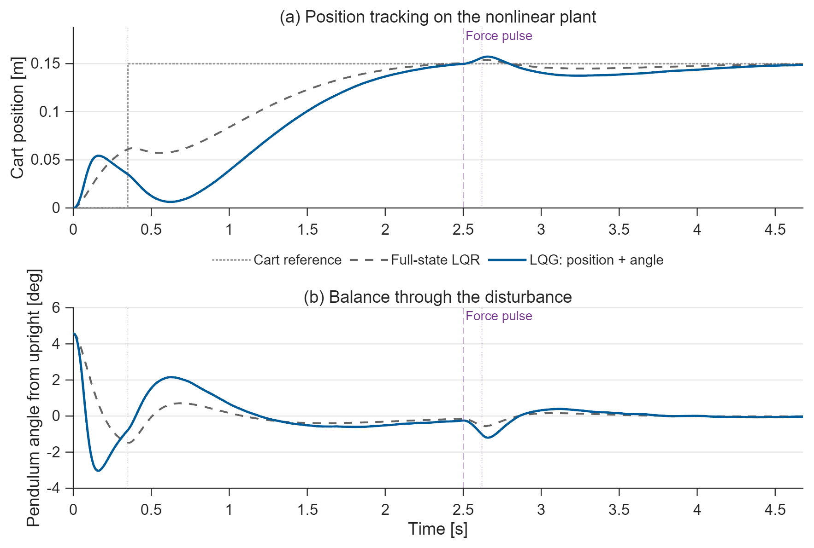
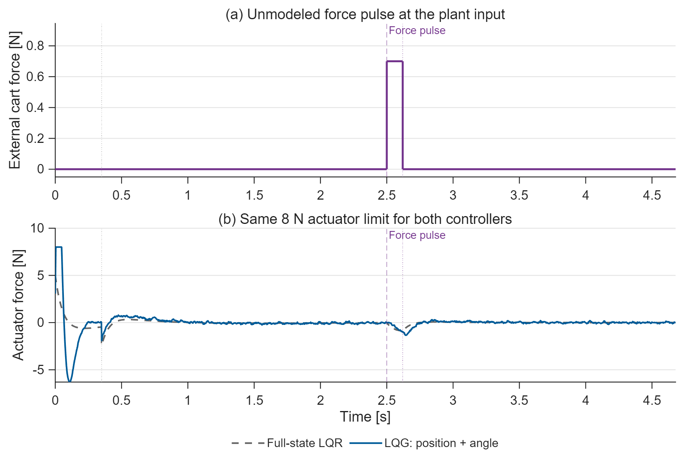
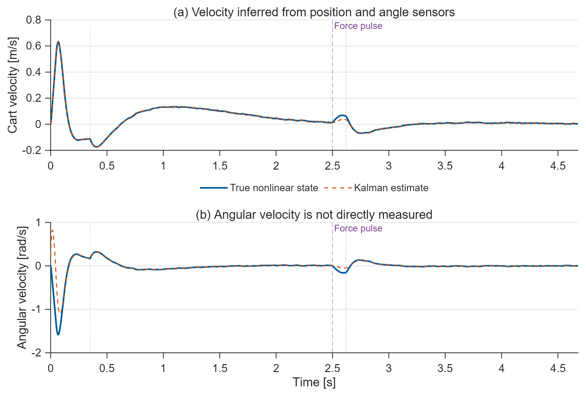
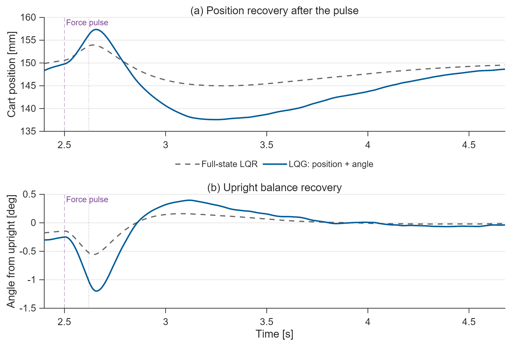

# Inverted Pendulum: LQR and LQG

A nonlinear cart-pendulum with sampled LQR, a steady-state Kalman estimator,
actuator saturation, measurement noise, and an external force pulse.

## Run

Requires **MATLAB, Simulink and Control System Toolbox**; verified on **R2025b**.
Open this folder in MATLAB and run `run_demo` or `run_demo(false)`.
The editable `cart_pendulum.slx` separates **NonlinearPlant**, **KalmanEstimator**,
and **Controller**. Parameters, design and nonlinear equations are in separate
short functions. State order: cart position, velocity, upright angle, angular velocity.

## Results

**Figure 1. Tracking and balance.** From a 4.58-degree initial lean, the cart
receives a 0.15 m request at 0.35 s and a marked 0.7 N disturbance from 2.50 to
2.62 s. Both controllers recover. Full-state LQR has ideal access to every state;
LQG receives only noisy position and angle and estimates both velocities.
They are different sensing configurations, not a claim that LQG outperforms ideal LQR.

**Figure 2. Force budget.** Both controllers have the same 8 N actuator limit
and force-noise realization. LQG reaches the limit during initial estimator
convergence; full-state LQR peaks at 5.01 N. The external pulse enters the plant,
not the estimator's known-actuator input.

**Figure 3. Unmeasured velocities.** The Kalman filter reconstructs cart and
angular velocity from the two encoder channels and the applied actuator command.
Noise is seeded and repeatable; no numerical differentiation of encoder readings
is used.

**Figure 4. Recovery after the force pulse.** This close-up uses the same data
as Figure 1. Both controllers return inside the position and angle tolerances;
post-pulse settling is 1.236 s for LQR and 1.714 s for LQG in this realization.
Every figure marks pulse onset and completion.

The common 4.678 s endpoint includes 20% headroom after the slower recovery.
Settling tolerances are 3 mm (2% of the position request) and 0.0016 rad
(2% of the initial lean). Residual fluctuations remain because noise continues.
PNG previews, vector PDFs, full CSV data, gains, covariances and metrics are in `results/`.

## Design and verification

LQR and Kalman gains are designed from the upright linearization at 500 Hz.
The plant remains nonlinear; the estimator is linear. Sensor standard deviations
are 0.3 mm and 0.0007 rad, and force-noise standard deviation is 0.02 N per sample.
Kalman process covariance is a stated design assumption, distinct from sensor
noise and the simulated force sequence. The random seed is 73.

`run_demo` checks controllability, observability, the analytical linearization,
controller/estimator stability, force bounds, upright recovery and sample-by-sample
agreement between Simulink and a separate RK4 implementation. This is local
stabilization near upright, not swing-up or a global stability guarantee.

Topic: **P05** in Muhammad Mudassir Shakeel's
[*MATLAB, Simulink & Simscape Project-Based Masterbook*](https://buymeacoffee.com/engrprogrammer),
extended with LQG. This is a fresh implementation and repository, not a fork of
the previous Control Bootcamp project. [MIT License](LICENSE).
